[README.md](https://github.com/user-attachments/files/33356108/README.md)
# Deep Learning Failure Lab

A PyTorch-based experimental project for diagnosing, visualizing, and fixing common neural network training failures on CIFAR-10.

Deep Learning Failure Lab is an experiment-driven deep learning project that studies **why neural networks fail during training and how different training strategies affect optimization and generalization**.

Instead of only training a classifier, this project intentionally creates failure cases and analyzes them through:

- weight initialization
- gradient propagation
- optimizer selection
- learning-rate sensitivity
- overfitting
- dropout
- weight decay
- data augmentation
- early stopping
- transfer learning

The goal is to connect deep learning theory with observable training behavior.

---

# Key Results

| Experiment | Main Result |
|---|---|
| Zero Initialization | Training loss stayed near 2.30 and hidden-layer weight gradients collapsed to zero |
| Xavier Initialization | Restored non-zero gradient flow and stable training |
| He Initialization | Produced stable gradient propagation for ReLU-based networks |
| SGD | 48.78% test accuracy |
| Momentum | 48.13% test accuracy after learning-rate tuning |
| Adam | 47.32% test accuracy |
| No Regularization | Clear train-test generalization gap |
| Dropout 0.5 | Excessive regularization caused underfitting |
| Dropout 0.2 | Reduced the generalization gap but lowered overall performance |
| Weight Decay | Produced performance close to the unregularized baseline |
| Data Augmentation | Strongly reduced the train-test performance gap |
| Early Stopping | Best checkpoint occurred at epoch 14 |
| Transfer Learning | Pretrained ResNet18 reached 76.43% test accuracy |

The strongest result in the project was obtained through transfer learning:

**MLP from scratch: ~40% → Pretrained ResNet18: 76.43%**

---

# Motivation

A neural network can fail even when the code itself runs correctly.

Common causes include:

- poor parameter initialization
- vanishing or unstable gradients
- unsuitable learning rates
- optimizer misconfiguration
- excessive model capacity
- insufficient training data
- overfitting
- excessive regularization

This project treats neural network training as a system that can be:

```text
Observed
    ↓
Measured
    ↓
Diagnosed
    ↓
Modified
    ↓
Compared
````

The general workflow used throughout the project is:

```
Create a Failure Case
        ↓
Observe Training Behavior
        ↓
Measure Loss / Accuracy / Gradients
        ↓
Diagnose the Problem
        ↓
Apply a Possible Fix
        ↓
Compare the Results
```

---

# Dataset

All experiments use the **CIFAR-10** image classification dataset.

CIFAR-10 contains 10 classes:

- airplane
- automobile
- bird
- cat
- deer
- dog
- frog
- horse
- ship
- truck

Each image has shape:

```
3 × 32 × 32
```

For the overfitting and transfer-learning experiments, the training dataset was intentionally reduced to **5,000 samples** in order to study limited-data behavior and generalization.

---

# Experiment 1 — Initialization and Gradient Diagnostics

The first experiment studies how weight initialization affects gradient propagation and neural network training.

The following initialization strategies were compared:

- baseline initialization
- zero initialization
- Xavier initialization
- He initialization

---

## Zero Initialization Failure

All linear-layer weights and biases were initialized to zero.

The resulting hidden-layer gradient norms were:

```
fc1.weight: 0.00000000
fc1.bias:   0.00000000

fc2.weight: 0.00000000
fc2.bias:   0.00000000

fc3.weight: 0.00000000
fc3.bias:   0.16109550
```

The model's training loss remained approximately:

```
2.303
```

across all five epochs.

For a 10-class classification problem, random guessing produces a cross-entropy loss close to:

```
-ln(0.1) ≈ 2.3026
```

This shows that the model was effectively unable to learn meaningful features.

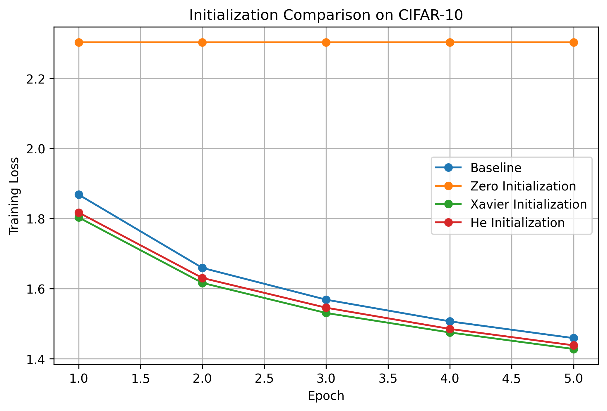


---

## Xavier Initialization

Xavier initialization produced non-zero weight gradients:

```
fc1.weight: 8.05469608
fc1.bias:   0.25799826

fc2.weight: 3.75232983
fc2.bias:   0.31680450

fc3.weight: 2.61013484
fc3.bias:   0.36008838
```

Training loss decreased from:

```
1.8032
```

to:

```
1.4279
```

after five epochs.

Final test accuracy:

```
47.32%
```

---

## He Initialization

He initialization produced:

```
fc1.weight: 10.63903332
fc1.bias:   0.31515828

fc2.weight: 4.54047728
fc2.bias:   0.29906720

fc3.weight: 3.07018447
fc3.bias:   0.26956019
```

Training loss decreased from:

```
1.8172
```

to:

```
1.4383
```

after five epochs.

Final test accuracy:

```
48.23%
```

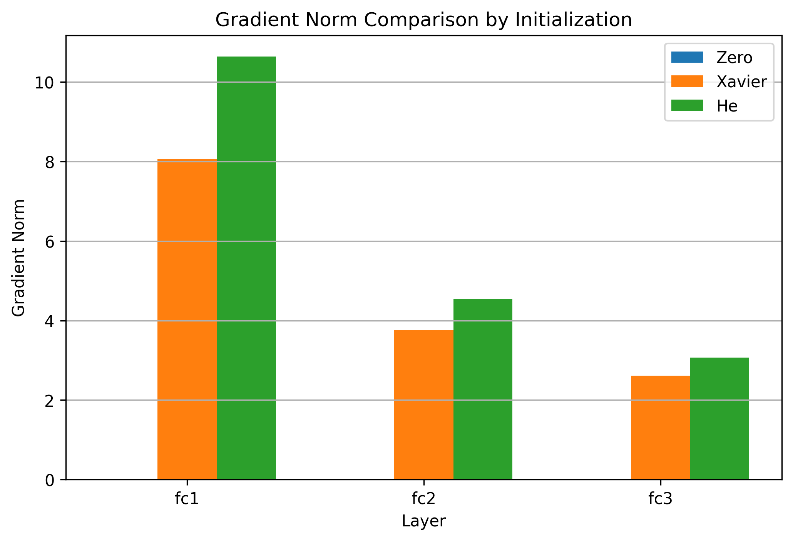


---

## Experiment 1 Finding

Zero initialization prevented the hidden layers from learning because their weight gradients collapsed to zero.

Xavier and He initialization successfully restored non-zero gradient flow and enabled stable optimization.

The main lesson is:

> Weight initialization affects whether useful gradient-based learning can occur at all.

---

# Experiment 2 — Optimizer Comparison

The second experiment compares three optimization methods:

- SGD
- SGD with Momentum
- Adam

All models used:

- the same `SimpleMLP`
- the same CIFAR-10 dataset
- He initialization
- the same five-epoch training duration

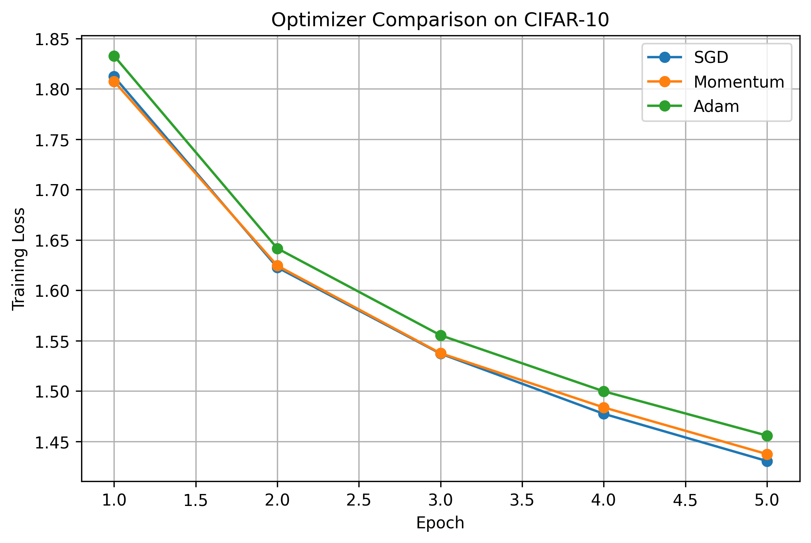


---

## Final Optimizer Results

| Optimizer | Learning Rate | Final Training Loss | Test Accuracy |
| --------- | ------------- | ------------------- | ------------- |
| SGD       | 0.01          | 1.4305              | 48.78%        |
| Momentum  | 0.001         | 1.4374              | 48.13%        |
| Adam      | 0.0003        | 1.4558              | 47.32%        |

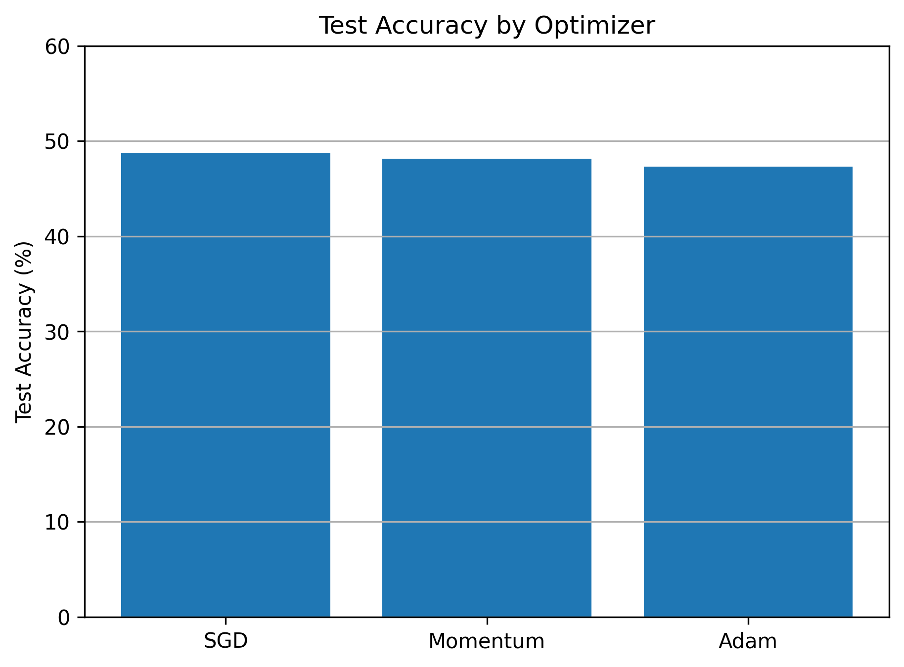


These results should not be interpreted as a universal ranking of optimizers.

In this particular experiment:

- SGD slightly outperformed the other methods
- Momentum performed similarly after tuning
- Adam also converged normally after tuning

Optimizer performance depends on:

- architecture
- learning rate
- initialization
- dataset
- batch size
- training duration

---

# Learning Rate Failure Case

A particularly useful failure case appeared with Momentum.

Using:

```
learning rate = 0.01
momentum = 0.9
```

produced poor training behavior:

```
Epoch 1 Loss: 2.0907
Epoch 2 Loss: 2.0319
Epoch 3 Loss: 2.0310
Epoch 4 Loss: 2.0361
Epoch 5 Loss: 2.0294
```

Final test accuracy was:

```
24.45%
```

After reducing the learning rate to:

```
0.001
```

the model recovered normal convergence:

```
Epoch 1 Loss: 1.8076
Epoch 2 Loss: 1.6245
Epoch 3 Loss: 1.5376
Epoch 4 Loss: 1.4837
Epoch 5 Loss: 1.4374
```

Final test accuracy increased to:

```
48.13%
```

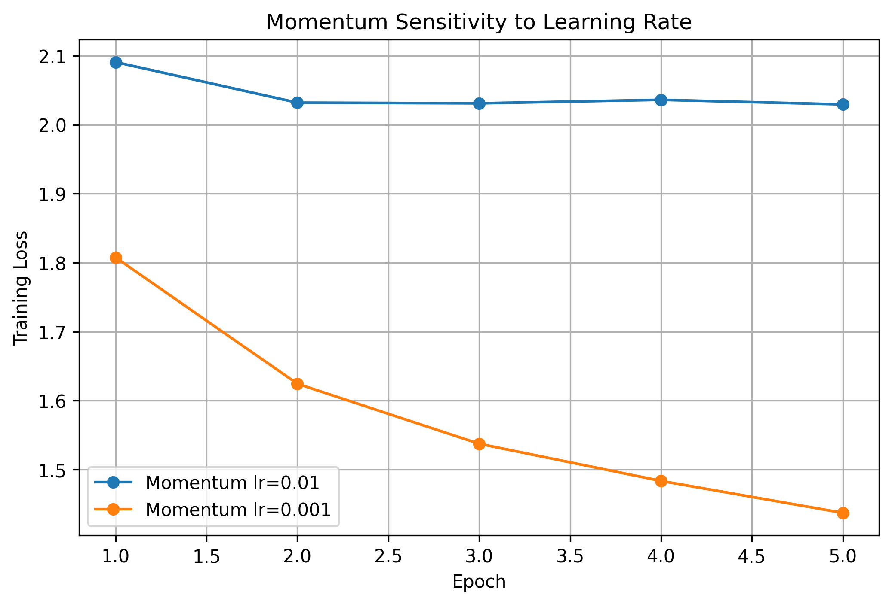


---

## Experiment 2 Finding

Optimizer choice alone is not enough.

A more sophisticated optimizer does not automatically produce better results.

The learning rate can determine whether optimization succeeds or fails.

---

# Experiment 3 — Overfitting and Generalization

The third experiment intentionally creates an overfitting scenario.

To make overfitting easier to observe:

- CIFAR-10 training data was reduced to 5,000 images
- model capacity was increased
- a larger MLP was trained for 20 epochs

The model architecture was:

```
3072
 ↓
1024
 ↓
512
 ↓
256
 ↓
10
```

Training accuracy continued increasing throughout training.

Final training accuracy:

```
54.20%
```

Final test accuracy:

```
40.37%
```

This created a clear generalization gap.

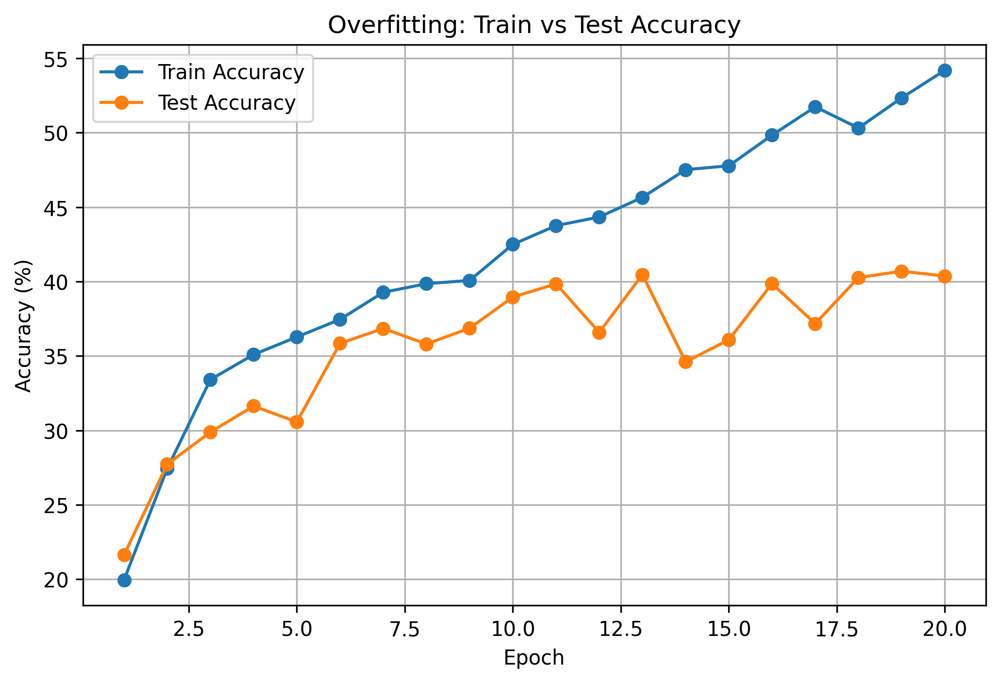


Training loss continued decreasing while test loss stopped improving consistently.

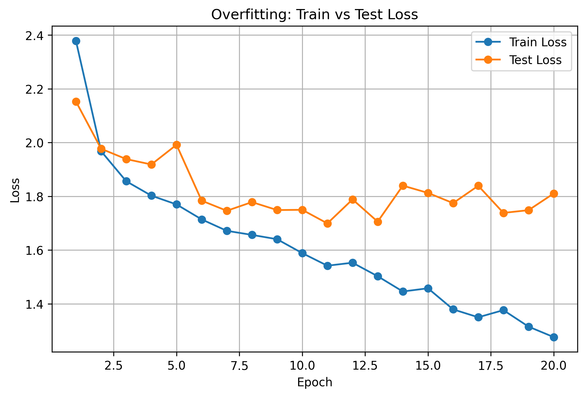


---

## Overfitting Observation

The important pattern was:

```
Training Accuracy
        ↑
        ↑
        ↑

Test Accuracy
        ↑
        →
        →
```

The model continued fitting the training data, while performance on unseen data stopped improving.

This is a classic sign of overfitting.

---

# Regularization Experiments

Several regularization strategies were evaluated:

- Dropout 0.5
- Dropout 0.2
- Weight Decay
- Data Augmentation
- Early Stopping

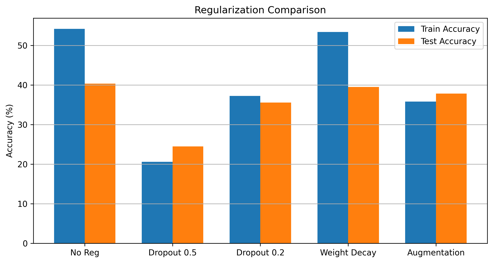


---

# Dropout 0.5

A dropout probability of:

```
0.5
```

was applied after each hidden ReLU layer.

Final results:

```
Train Accuracy: 20.60%
Test Accuracy:  24.47%
```

The generalization gap became small, but both training and test performance were poor.

This indicates **underfitting**.

The regularization was too strong for this particular model and dataset configuration.

---

# Dropout 0.2

The dropout rate was reduced to:

```
0.2
```

Final results:

```
Train Accuracy: 37.26%
Test Accuracy:  35.59%
```

The train-test gap became smaller compared with the unregularized model.

However, overall predictive performance also decreased.

---

## Dropout Finding

The dropout experiments demonstrate an important trade-off:

```
Too little regularization
        ↓
Overfitting

Too much regularization
        ↓
Underfitting
```

Regularization strength must therefore be tuned rather than treated as a fixed solution.

---

# Weight Decay

Weight decay was applied using:

```
weight_decay=1e-4
```

Final results:

```
Train Accuracy: 53.38%
Test Accuracy:  39.51%
```

These results were close to the unregularized baseline.

In this particular setup, weight decay did not significantly improve final test accuracy.

This is an important practical result:

> A theoretically useful method does not necessarily improve every model configuration.

---

# Data Augmentation

Training images were augmented using:

```
RandomCrop
RandomHorizontalFlip
```

Final results:

```
Train Accuracy: 35.82%
Test Accuracy:  37.83%
```

The train-test gap became very small.

Interestingly, test accuracy became slightly higher than training accuracy.

This can happen because training images were randomly transformed, making the training task harder than evaluation on the original test images.

Data augmentation strongly reduced the generalization gap, although it did not outperform the unregularized model in final test accuracy.

---

# Early Stopping

Early stopping was implemented by monitoring evaluation loss.

Configuration:

```
Maximum Epochs: 50
Patience:       5
```

Training automatically stopped at:

```
Epoch 19
```

The lowest evaluation loss occurred at:

```
Epoch 14
```

The best model state was saved and restored after training.

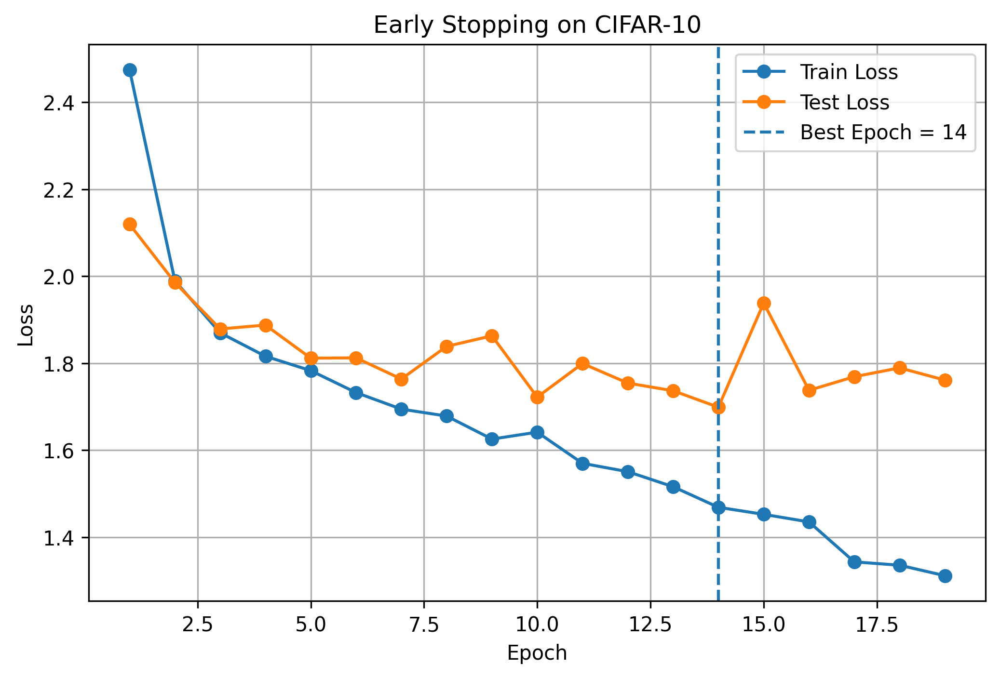


The important behavior was:

```
Training Loss
    ↓
    ↓
    ↓

Evaluation Loss
    ↓
    ↓
    ↑
    ↑
```

Training continued to fit the training data, while generalization performance no longer improved.

---

## Experiment 3 Finding

Regularization is not simply about making the model smaller or weaker.

Each method changes the training process differently.

The experiments showed:

- no regularization → overfitting
- strong dropout → underfitting
- moderate dropout → smaller generalization gap
- weight decay → limited effect in this configuration
- augmentation → reduced train-test gap
- early stopping → prevented unnecessary continued training

---

# Experiment 4 — Transfer Learning

The final experiment evaluates transfer learning using a pretrained **ResNet18** model.

The ResNet18 model was initialized with pretrained ImageNet weights.

Because CIFAR-10 contains 10 classes, the original ResNet18 classification layer:

```
512 → 1000
```

was replaced with:

```
512 → 10
```

The pretrained feature extractor was frozen.

Only the final classification layer was trained.

---

# Parameter Efficiency

Total ResNet18 parameters:

```
11,181,642
```

Trainable parameters:

```
5,130
```

The number of trainable parameters was calculated as:

```
512 × 10 + 10 = 5,130
```

Therefore, only a very small fraction of the complete ResNet18 model was updated during training.

---

# Transfer Learning Results

The pretrained ResNet18 was trained for five epochs using only 5,000 CIFAR-10 training images.

Results:

| Epoch | Train Accuracy | Test Accuracy |
| ----- | -------------- | ------------- |
| 1     | 56.20%         | 70.43%        |
| 2     | 73.82%         | 72.53%        |
| 3     | 75.92%         | 75.26%        |
| 4     | 78.06%         | 75.90%        |
| 5     | 78.58%         | 76.43%        |

Final test accuracy:

```
76.43%
```

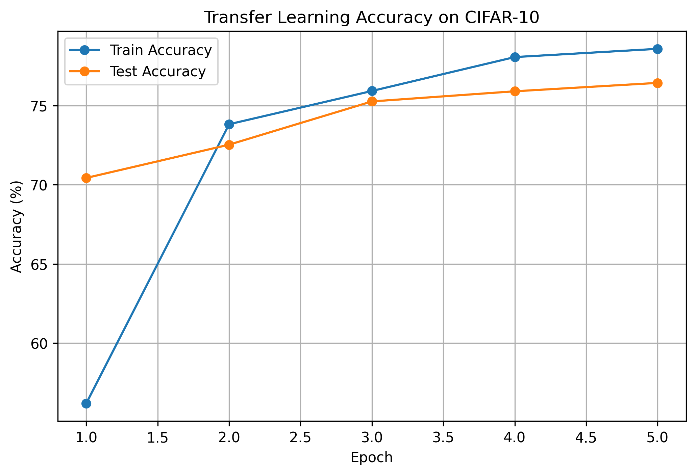


Training and test loss both decreased consistently:

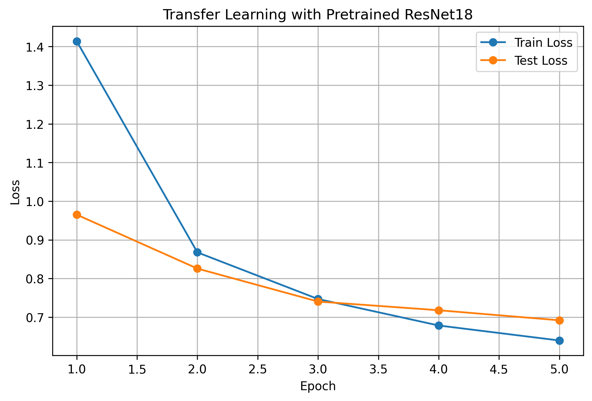


---

# From Scratch vs Transfer Learning

The strongest result in the project is the difference between the MLP trained from scratch and the pretrained ResNet18.

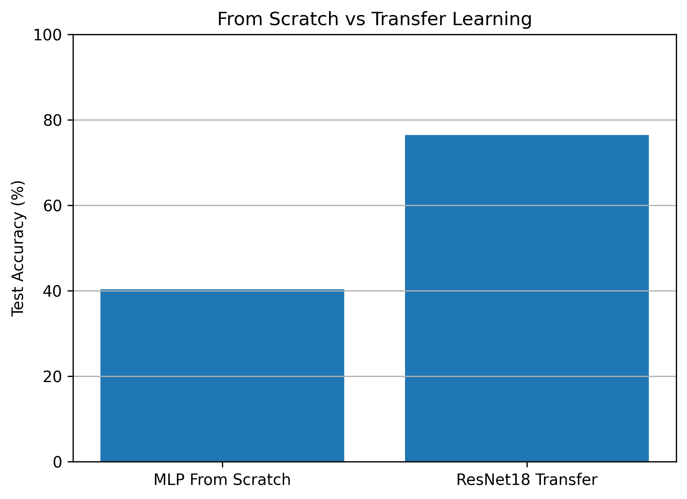


Approximate final test accuracy:

```
MLP From Scratch    ≈ 40%
ResNet18 Transfer   ≈ 76%
```

This corresponds to an improvement of approximately:

```
+36 percentage points
```

while training only:

```
5,130 parameters
```

---

## Experiment 4 Finding

Transfer learning produced by far the strongest performance in the project.

The result demonstrates that features learned from a large external dataset can be successfully reused for a related image-classification task.

Instead of learning every visual representation from scratch, the pretrained model already contains useful feature extractors.

---

# Project Structure

```
deep-learning-failure-lab/
│
├── notebooks/
│   └── 01_lecture3_training_diagnostics.ipynb
│
├── src/
│   ├── models.py
│   ├── train.py
│   └── diagnostics.py
│
├── results/
│   ├── figures/
│   │   ├── early_stopping.png
│   │   ├── gradient_norm_comparison.png
│   │   ├── initialization_comparison.png
│   │   ├── momentum_lr_sensitivity.png
│   │   ├── optimizer_accuracy.png
│   │   ├── optimizer_comparison.png
│   │   ├── overfitting_accuracy.png
│   │   ├── overfitting_loss.png
│   │   ├── regularization_comparison.png
│   │   ├── scratch_vs_transfer.png
│   │   ├── transfer_learning_accuracy.png
│   │   └── transfer_learning_loss.png
│   │
│   └── metrics/
│       ├── early_stopping_results.csv
│       ├── initialization_results.csv
│       ├── optimizer_results.csv
│       ├── regularization_results.csv
│       └── transfer_learning_results.csv
│
├── README.md
├── requirements.txt
└── .gitignore
```

---

# Source Code

The project separates reusable code from exploratory notebook experiments.

---

## `src/models.py`

Contains reusable neural network architectures:

```
SimpleMLP
LargeMLP
DropoutMLP
```

The dropout model accepts a configurable dropout probability, allowing experiments such as:

```
DropoutMLP(dropout_rate=0.5)
```

and:

```
DropoutMLP(dropout_rate=0.2)
```

---

## `src/train.py`

Contains reusable training utilities for:

- standard model training
- model evaluation
- train/test metric tracking
- early stopping
- best-model restoration

---

## `src/diagnostics.py`

Contains diagnostic utilities for:

- zero initialization
- Xavier initialization
- He initialization
- gradient norm extraction
- gradient reporting

---

# Technologies

The project uses:

- Python
- PyTorch
- Torchvision
- NumPy
- Pandas
- Matplotlib
- Jupyter Notebook

Hardware acceleration supports:

- Apple MPS
- CUDA
- CPU

depending on the available machine.

---

# Installation

Clone the repository:

```
git clone <YOUR_REPOSITORY_URL>
```

Enter the project directory:

```
cd deep-learning-failure-lab
```

Install dependencies:

```
pip install -r requirements.txt
```

Launch Jupyter Notebook:

```
jupyter notebook
```

Open:

```
notebooks/01_lecture3_training_diagnostics.ipynb
```

and run the cells sequentially.

---

# Reproducing the Experiments

The notebook is organized around four main experiments:

```
Experiment 1
Initialization and Gradient Diagnostics

Experiment 2
Optimizer and Learning Rate Sensitivity

Experiment 3
Overfitting and Regularization

Experiment 4
Transfer Learning
```

Generated plots are stored under:

```
results/figures/
```

Generated numerical results are stored under:

```
results/metrics/
```

---

# Saved Metrics

The project exports experiment results to CSV files for reproducibility and further analysis.

Available metrics include:

```
initialization_results.csv
optimizer_results.csv
regularization_results.csv
early_stopping_results.csv
transfer_learning_results.csv
```

---

# Main Concepts Demonstrated

This project covers:

- automatic differentiation
- backpropagation
- gradient propagation
- gradient diagnostics
- symmetry breaking
- zero initialization
- Xavier initialization
- He initialization
- stochastic gradient descent
- momentum
- Adam
- learning-rate sensitivity
- overfitting
- underfitting
- generalization
- dropout
- weight decay
- data augmentation
- early stopping
- transfer learning
- pretrained models
- frozen feature extractors

---

# Key Lessons

## 1. Initialization matters

Poor initialization can prevent gradient-based learning entirely.

## 2. Gradient flow can be measured

Gradient norms provide direct diagnostic information about whether different parts of a network are receiving useful training signals.

## 3. More advanced optimizers are not automatically better

Adam, Momentum, and SGD each depend on hyperparameter configuration.

A badly tuned optimizer can fail even when the algorithm itself is valid.

## 4. Learning rate is critical

The Momentum experiment showed that changing only the learning rate changed test accuracy from approximately:

```
24%
```

to:

```
48%
```

## 5. Training accuracy is not enough

A model can continue improving on the training set while performance on unseen data stops improving.

## 6. Regularization introduces trade-offs

Regularization can reduce overfitting, but excessive regularization can create underfitting.

## 7. Early stopping protects generalization

Monitoring evaluation loss can prevent unnecessary training after generalization performance stops improving.

## 8. Transfer learning is highly effective

Pretrained visual representations produced much stronger performance than training an MLP from scratch using the limited dataset.

---

# Limitations

This project is designed primarily as a training-diagnostics study rather than a state-of-the-art CIFAR-10 benchmark.

Several limitations should be noted:

1. Many experiments use MLPs rather than CNNs.
2. The training set was intentionally reduced to 5,000 images in several experiments.
3. Optimizer comparisons use short five-epoch training runs.
4. Optimizer learning rates were manually selected rather than determined through a full hyperparameter search.
5. The transfer-learning comparison uses a pretrained ResNet18 and a scratch-trained MLP, so the architectures are different.
6. Evaluation behavior in the notebook uses the CIFAR-10 test set during experimentation. A production-grade experiment should use separate training, validation, and final test splits.

These choices were intentional for demonstrating deep learning training behavior and failure modes.

---

# Future Work

Possible extensions include:

- CNN-based diagnostic experiments
- Batch Normalization experiments
- deeper-network vanishing-gradient analysis
- exploding-gradient experiments
- gradient clipping
- learning-rate schedulers
- confusion matrices
- per-class accuracy
- partial ResNet fine-tuning
- full ResNet fine-tuning
- automated hyperparameter search
- automated failure detection
- automatic training recommendations
- interactive Streamlit dashboard
- experiment configuration files
- model checkpoint management
- TensorBoard integration

A future version of the project could automatically detect:

```
Vanishing Gradient
Exploding Gradient
Overfitting
Underfitting
Unstable Optimization
Poor Learning Rate
```

and recommend possible fixes.

---

# Future Platform Direction

The long-term goal is to extend this project from a collection of controlled experiments into an interactive neural network diagnostics platform.

A future workflow could look like:

```
Upload / Select Dataset
        ↓
Choose Model
        ↓
Choose Initialization
        ↓
Choose Optimizer
        ↓
Train Model
        ↓
Monitor Gradients and Metrics
        ↓
Automatically Detect Failure Patterns
        ↓
Recommend Possible Fixes
```

Potential interface features include:

- real-time loss visualization
- gradient norm monitoring
- weight norm monitoring
- optimizer comparison
- initialization comparison
- automatic overfitting detection
- learning-rate diagnostics
- training recommendations

---

# Author

**Zhongbo Liu**

Deep Learning Training Diagnostics Project
